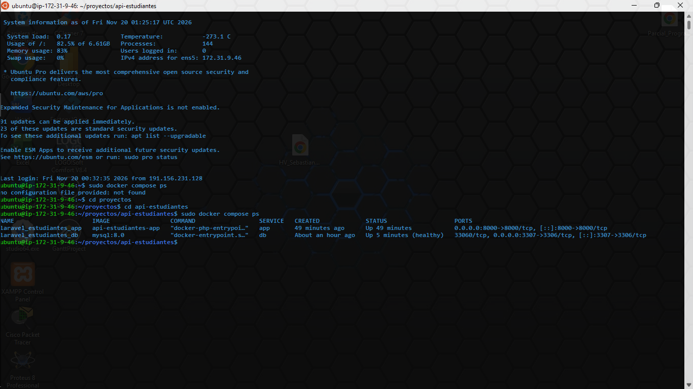
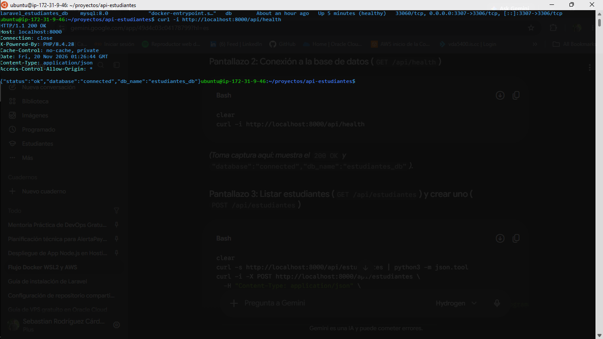
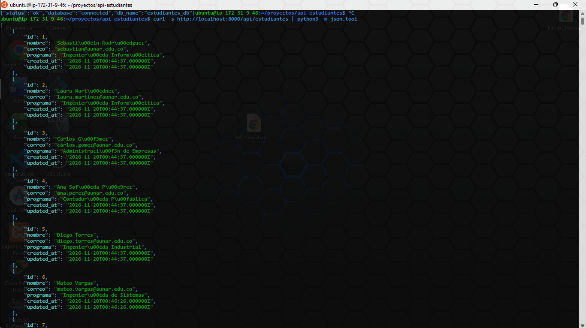
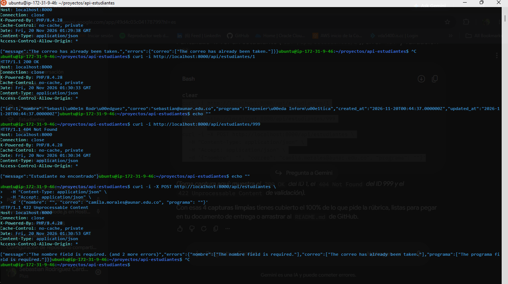

# API REST de Registro de Estudiantes (Laravel + MySQL + Docker)

API desarrollada en **Laravel** con base de datos **MySQL 8.0**, orquestada en contenedores separados (`app` y `db`) mediante **Docker Compose**.

## Requisitos previos
* Docker y Docker Compose instalados.

## Pasos de ejecución

1. **Clonar el repositorio y entrar al directorio:**
       git clone https://github.com/ingSebasRC/api-estudiantes.git
       cd api-estudiantes

2. **Configurar variables de entorno:**
       cp .env.example .env

3. **Construir y levantar los contenedores (`app` y `db`):**
       docker compose up -d --build

4. **Instalar dependencias de Composer y generar la clave de aplicación:**
       docker compose exec app composer install
       docker compose exec app php artisan key:generate

5. **Ejecutar las migraciones y poblar la base de datos con los 5 registros iniciales:**
       docker compose exec app php artisan migrate --seed

6. **Verificar el estado de los contenedores:**
       docker compose ps

## Endpoints disponibles

| Método | Ruta | Descripción |
| :--- | :--- | :--- |
| `GET` | `/api/health` | Verifica el estado de la API y la conexión con MySQL. |
| `GET` | `/api/estudiantes` | Lista todos los estudiantes registrados. |
| `POST` | `/api/estudiantes` | Registra un nuevo estudiante (valida `nombre`, `correo` único y `programa`). |
| `GET` | `/api/estudiantes/{id}` | Consulta un estudiante por su ID o retorna error `404`. |

---

## Pregunta teórica: ¿Por qué `DB_HOST` debe ser `db` y no `localhost`?

En Docker, cada contenedor posee su propia interfaz de red aislada (`loopback`). Si se configura `DB_HOST=localhost` (o `127.0.0.1`) dentro de la aplicación Laravel, el contenedor `app` intentará conectarse a un servidor MySQL ejecutándose dentro de **sí mismo**, lo cual fallará con un error de conexión rechazada (*Connection refused*) porque MySQL corre en otro contenedor separado.

Al levantar los servicios con **Docker Compose**, ambos contenedores (`app` y `db`) se conectan automáticamente a una misma red virtual interna (`bridge`). Docker proporciona un servidor **DNS embebido** dentro de esa red que resuelve los nombres de los servicios definidos en el archivo `docker-compose.yml` hacia sus direcciones IP internas correspondientes. Por ello, al establecer `DB_HOST=db`, el contenedor `app` localiza y se comunica directamente con el contenedor de base de datos `db`.

---

## Evidencias de funcionamiento

### 1. Contenedores activos (`docker compose ps`)

### 2. Verificación de salud y conexión a MySQL (`GET /api/health`)

### 3. Listado de estudiantes (`GET /api/estudiantes`)

### 4. Registro de estudiante y validación de correo único (`POST /api/estudiantes`)

### 5. Consulta por ID (`200 OK`), no encontrado (`404`) y validación de campos (`422`)

